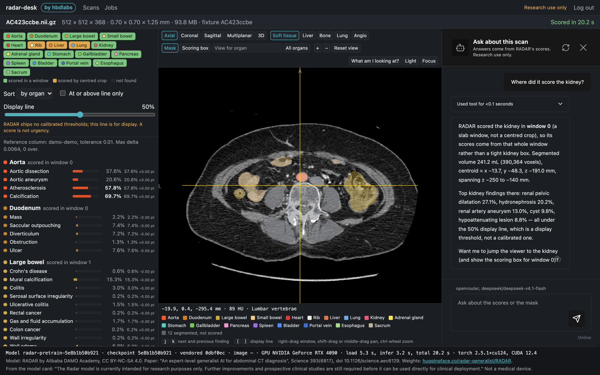

# radar-desk

Runs RADAR (Alibaba DAMO Academy's abdominal CT model, Science 2026) on a CT scan. Shows the 146 finding scores next to the image with RADAR's organ outlines, plus a chat that explains the scores and moves the viewer. Optionally, NVIDIA's NV-Reason-CT reads the same scan and writes its own report, shown next to RADAR's scores and the radiologist's report.

Research use only. Not a medical device.



## Use

- Upload a `.nii` / `.nii.gz` scan and press Score.
- Add the radiologist's report from the scan bar ("Add report": paste it or choose a `.txt` file). Optional.
- NV-Reason-CT findings tab: NV-Reason-CT's impression on top, then every finding grouped by what the radiologist's report, RADAR and NV-Reason-CT say about it, into where they disagree (one says present, another absent), what NV-Reason-CT found, what only the others found, and what lies outside NV-Reason-CT's view. Click a finding to jump to the organ and read each one's own words. RADAR counts as present at the display line set on the RADAR findings tab. The attached report and NV-Reason-CT's report are read by the chat model you set in `CHAT_MODEL`, so the grouping needs one. "NV's view" in the viewer draws the part of the scan NV-Reason-CT reads. "Open reports" puts both full reports side by side in a window of their own, with NV-Reason-CT's reasoning and every answer it gave.
- Ask NV-Reason-CT: press a prepared question in the NV-Reason-CT findings tab, or ask in the chat. The first question after a few idle minutes takes about 2 minutes while the model wakes up; follow-ups take seconds.
- Click a finding or organ to jump to it.
- `w` what am I looking at · `m` main + reference views · `f` focus mode · `1`-`5` window presets · `+` `-` zoom.
- Light panel: window/level in HU, gamma, invert, colour map.
- "View for {organ}": the organ's standard reading window, centred and zoomed.
- Ask the chat: "show me the liver", "what is above 50%?", "what am I looking at?".
- Export scores (CSV, JSON) and the organ mask (NIfTI).

Scores are similarity to a finding's text, not calibrated probabilities. The 50% line is for display only.

## Run

Needs `uv` and Node. Cloud accounts only for the mode you pick (see Compute); everything on one machine: see Local.

```sh
uv sync
cd web && npm install && npm run build && cd ..
cp .env.example .env        # fill in the settings it lists
set -a && source .env && set +a && uv run modal deploy worker/modal_app.py   # Modal mode only
set -a && source .env && set +a && uv run modal deploy worker/nvreason_app.py   # optional second reader, Modal mode only
uv run python -m radar_desk  # http://127.0.0.1:8000, log in with OWNER_TOKEN
```

`OWNER_TOKEN` and `SESSION_SECRET`: long random strings, e.g. `openssl rand -hex 32`. `OWNER_TOKEN` is the login (and `Authorization: Bearer` for the API); changing either logs everyone out. Workers never get it: each gets its own revocable token on the jobs page.

`GPU_BACKEND=fake` runs without a GPU (results marked fake).

## Local

App, storage, GPU and chat on your own machines, no cloud. In `.env`:

```sh
STORAGE_BACKEND=local     # files under DATA_DIR
GPU_BACKEND=worker        # own GPU workers
LLM_PROVIDER=ollama       # optional local chat: Ollama running, ollama pull qwen3:8b
CHAT_MODEL=qwen3:8b
```

1. Build the worker image: `docker buildx build --platform linux/amd64 -f worker/docker/Dockerfile -t radar-worker .`
2. Start the app: `uv run python -m radar_desk`, open http://127.0.0.1:8000.
3. Jobs page: create a worker token, copy the run line, run it on an NVIDIA machine (24 GB) that reaches the app. First start downloads the weights (about 2 GB) into the `radar-weights` Docker volume.
4. Same machine as the app: the line has `--network host` (Linux). Docker Desktop (Mac, Windows): drop it and use `RADAR_DESK_URL=http://host.docker.internal:8000`.
5. Other machine: start the app with `HOST=0.0.0.0`, open it at its LAN address before copying the run line, and build the image on the GPU machine.

No NVIDIA card: `GPU_BACKEND=fake` shows the app with fake scores; `scripts/score_local.py` scores one scan on an Apple GPU or CPU; it needs torch and a local copy of the weights (see its header).

## Storage

Set in `.env`. Unset `STORAGE_BACKEND` means `s3` with `S3_BUCKET`, else `local`.

| `STORAGE_BACKEND` | Files go to | Compute modes that work |
|---|---|---|
| `s3` | S3-compatible bucket: set `S3_BUCKET` and the S3/AWS keys, allow the app's origin in the bucket's CORS | all |
| `local` | a folder under `DATA_DIR` on the app's machine | own GPU workers, RunPod pod |
| `modal_volume` | Modal Volume | Modal, own GPU workers, RunPod pod |
| `runpod_volume` | RunPod network volume | RunPod serverless, own GPU workers, RunPod pod |

The jobs page disables modes the storage or settings do not allow, with the reason; a saved mode that no longer fits falls back to own GPU workers. Move data between storages with `uv run python scripts/migrate_storage.py --from <old> --to <new>`.

## Compute

Pick on the jobs page (or `uv run python -m radar_desk.compute <mode>`):

| Mode | Setup |
|---|---|
| Modal | `modal deploy worker/modal_app.py` |
| Own GPU workers | Create a token on the jobs page, run the shown `docker run --gpus all ...` line on an NVIDIA machine that can reach the app. |
| RunPod pod | `RUNPOD_*` keys and `WORKER_IMAGE`. The app starts a pod when jobs are queued; it deletes itself after 10 idle minutes. Reaches the app via `WORKER_PUBLIC_URL` or a Cloudflare tunnel the app starts. |
| RunPod serverless | `uv run python scripts/runpod_endpoint.py create`, put `RUNPOD_ENDPOINT_ID` in `.env`. |

Own GPU: needs a 24 GB NVIDIA card. Tested on RunPod 4090 and L4 (same image), not yet on home or on-prem hardware. Apple GPU: `scripts/score_local.py --device mps` is correct but needs about 32 GB of memory.

New worker version: merge, tag `worker-vX.Y`, push the tag, set `WORKER_IMAGE=...:X.Y`. Then restart the app (pods), `scripts/runpod_endpoint.py update` (serverless), `modal deploy worker/modal_app.py` (Modal).

NV-Reason-CT (optional, Modal mode only): NVIDIA's CT model writes its own report of each scan, as a second reader next to RADAR. Deploy `worker/nvreason_app.py` (line above) and set `NVREASON_ENABLED=1`. Scoring a scan then also starts one NV-Reason-CT report on an L4, about 2 minutes including the model load. The first run downloads the model (10.6 GB) into the Modal Volume `nvreason-hf-cache`.

How NV-Reason-CT reads a scan: it sees a 384 mm cube at 2 mm resolution, placed on the abdomen from the base of the lungs down, so the lower pelvis can fall partly outside it. "NV's view" in the viewer shows the cube, and findings in organs mostly outside it are marked. After its report, the chat model reads that report and the radiologist's as a reading radiologist would, and writes follow-up questions NV-Reason-CT can answer about what it sees. The questions never tell it what the report or RADAR said. They are sent only when you press one, on the same L4, which stays up for 5 minutes after the last call and then stops. NV-Reason-CT counts against `GPU_MONTHLY_BUDGET_USD` like RADAR.

## Results

| Check | Result |
|---|---|
| vs DAMO's own script, same GPU | identical |
| vs DAMO's published demo | max diff 0.0064 |
| Modal L4 | 16 to 28 s per scan, about 3 cents |
| RunPod 4090 pod | 2.4 s scoring, about 2.5 min to start |
| RunPod serverless L4 | 20 s per scan, about 2.5 cents |

## Tests

`uv run pytest` and, in `web/`, `npm test`.

## Licence

CC BY-NC-SA 4.0 (includes and adapts RADAR's code). Model and weights by Alibaba DAMO Academy, [huggingface.co/radar-generalist/RADAR](https://huggingface.co/radar-generalist/RADAR). Paper: Science 393(6817), eaec6129, doi [10.1126/science.aec6129](https://doi.org/10.1126/science.aec6129). See `LICENSE` and `THIRD_PARTY_LICENSES.md`.

NV-Reason-CT by NVIDIA, [huggingface.co/nvidia/NV-Reason-CT](https://huggingface.co/nvidia/NV-Reason-CT), OpenMDW-1.1 licence, for research and educational use only. Paper: arXiv [2609.27511](https://arxiv.org/abs/2609.27511). The model is downloaded when it first runs, not included here.
